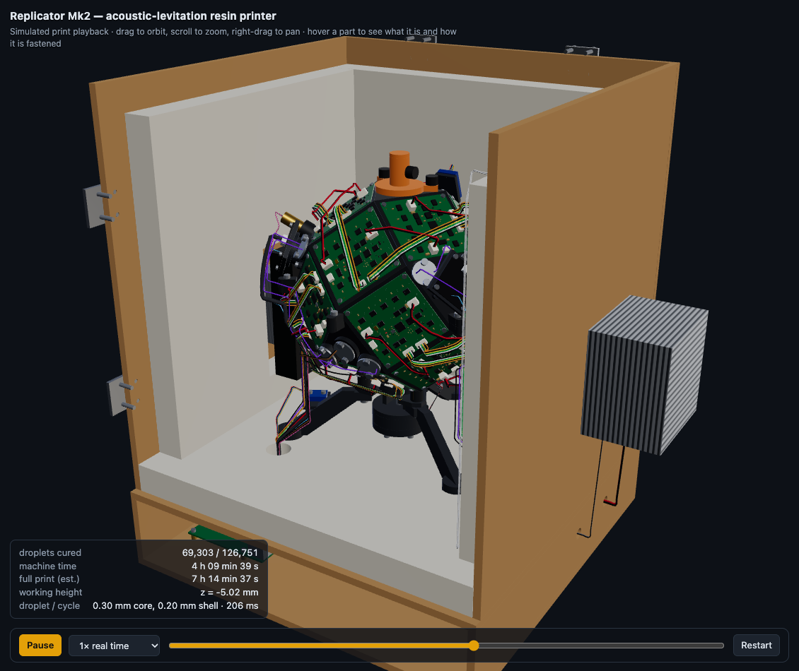
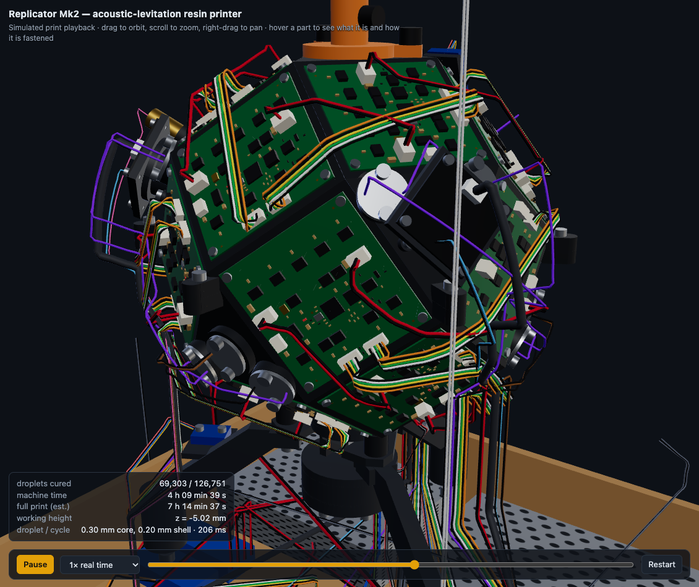
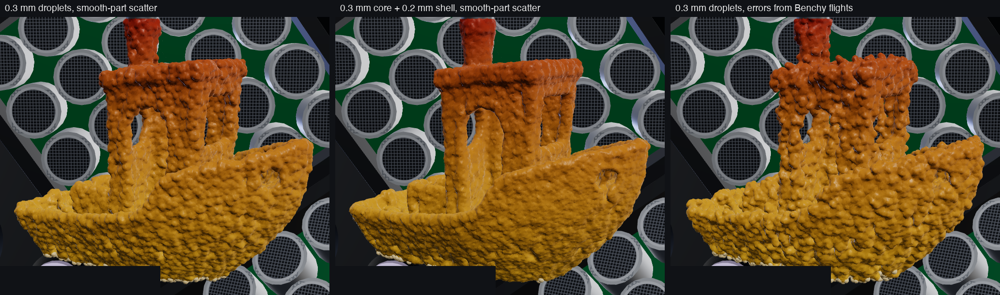
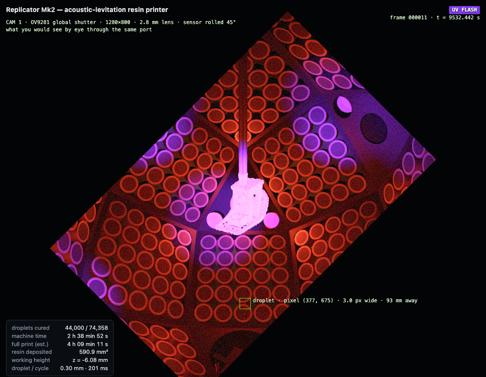
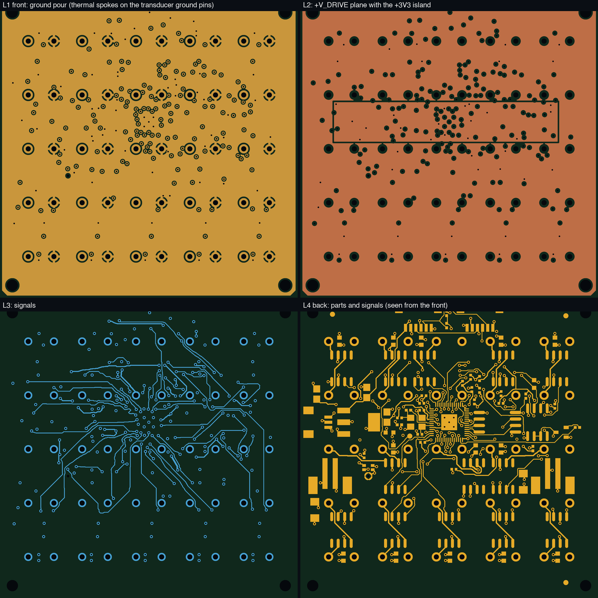

# acoustic-replicator

A feasibility study for a 3D printer that carries UV-resin droplets through the air with a 40 kHz ultrasonic phased array and cures them, one at a time, onto a part hanging on a pin. It includes the physics simulation, the full hardware design (printed frame, every bought part, screw and wire) and a routed transducer board ready for JLCPCB.

**Verdict:** the simulation says the idea is physically sound and worth a bench prototype. It does not prove the machine will print. Nothing has been built, there is no firmware, and the droplet generator has not been proven at this size. The full reasoning is in [REPORT.md](REPORT.md).



| | |
|---|---|
|  |  |
| 18 boards with 450 transducers on a rhombicuboctahedron | Simulated Benchy prints: one droplet size, fine shell, and Benchy-measured landing errors |
|  |  |
| In-camera view during a cure flash | TB-25 transducer board, 4 layers, routed and checked from its Gerber files |

## Key numbers (simulated)

- Landing: 42 of 42 flights on a smooth test part; 28 of 30 on real Benchy geometry.
- Print accuracy: mean surface error 0.05–0.09 mm, 0.14–0.38 s per droplet.
- Hardware: 1,197 solids with no overlaps; 224 wires terminated; 6 service motions with no collisions.
- Cost: about 1,400 USD without a host computer.

## Run

```sh
uv venv --python 3.12 .venv
uv pip install --python .venv/bin/python numpy scipy matplotlib numba scikit-image trimesh fast-simplification build123d gerbonara pyamg
.venv/bin/python viewer/serve.py 8791          # 3-D viewer at http://127.0.0.1:8791/viewer/
.venv/bin/python validation/v1_acoustics.py    # v1–v6: checks against exact solutions and cross-checks
.venv/bin/python studies/s16_hardware.py       # rebuild the machine model and its checks
.venv/bin/python -m replicator.pcbroute hardware/pcb   # route the board, write Gerbers, check them
```

Benchy studies need the public [3DBenchy](https://www.3dbenchy.com/) STL in `assets/benchy_download/`; it is not included here.

## Layout

- `replicator/`: acoustics, radiation force, hologram solver, droplet flight, print planner, cure model, structural model, CAD, PCB and router
- `validation/`, `studies/`: checks and experiments
- `hardware/`: STEP model, printable STLs, BOM, wiring, `pcb/` (Gerbers and JLCPCB files)
- `docs/`: droplet generator specification, assembly and service guide, images
