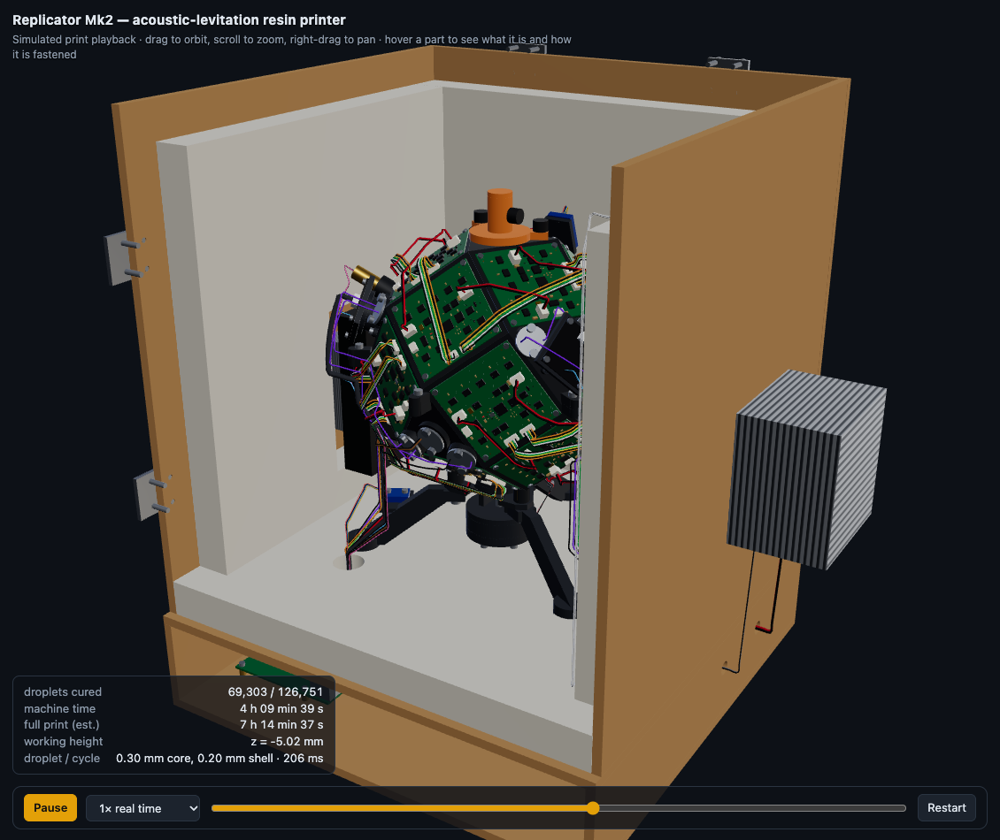
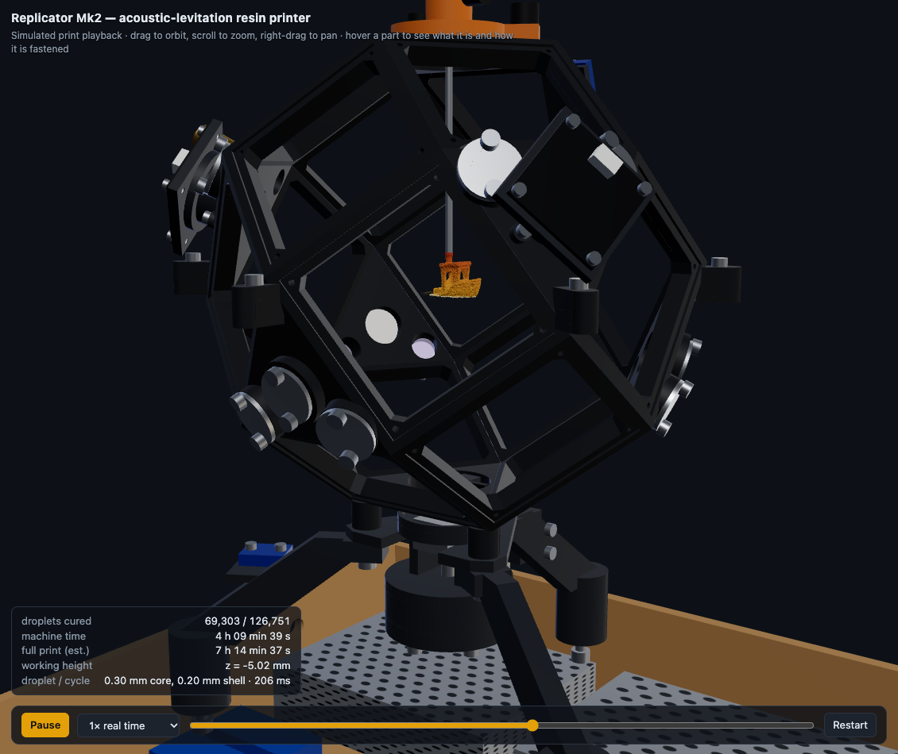
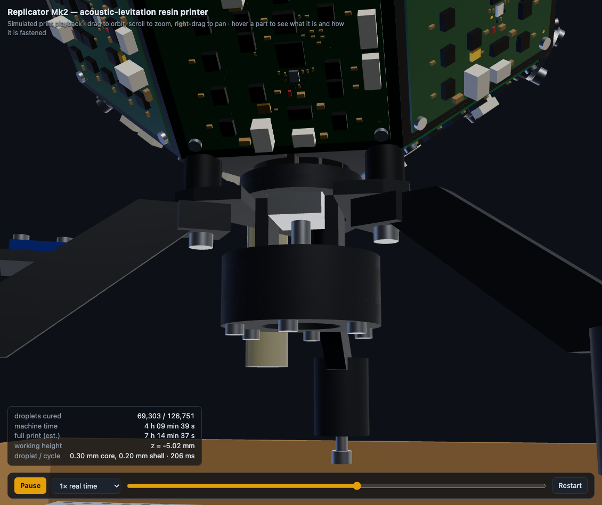
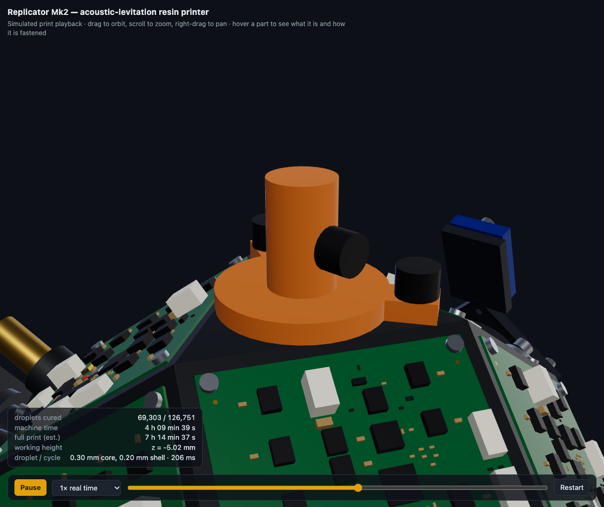
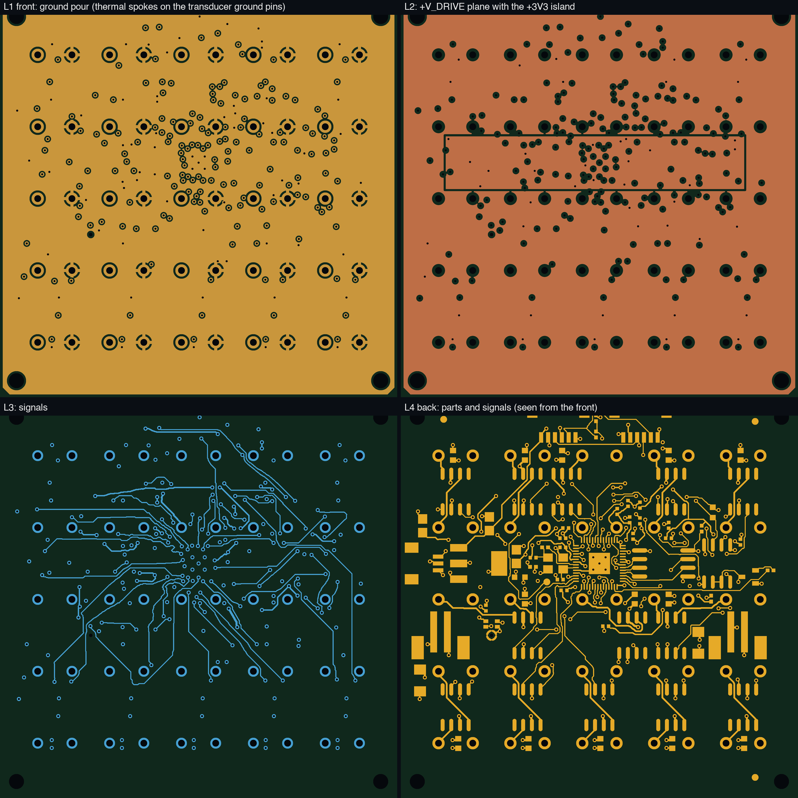
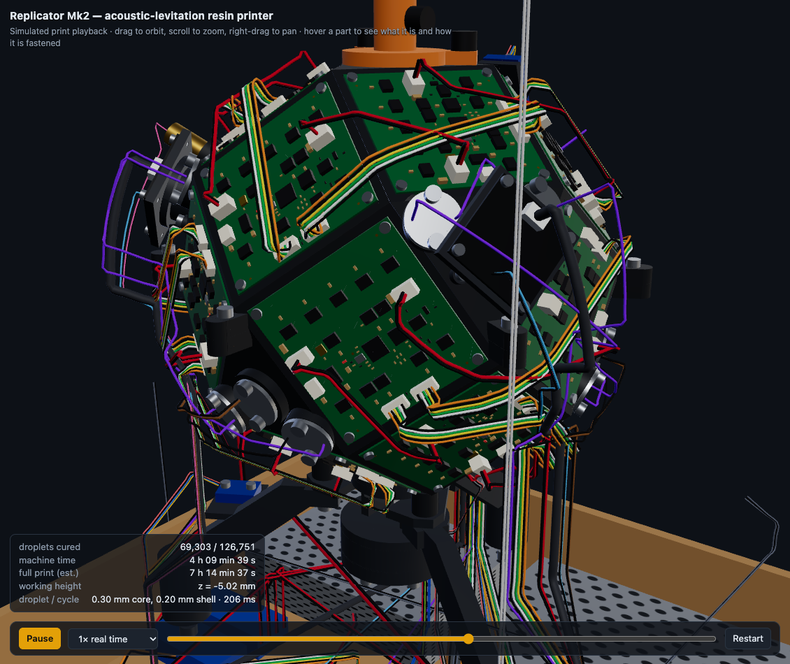
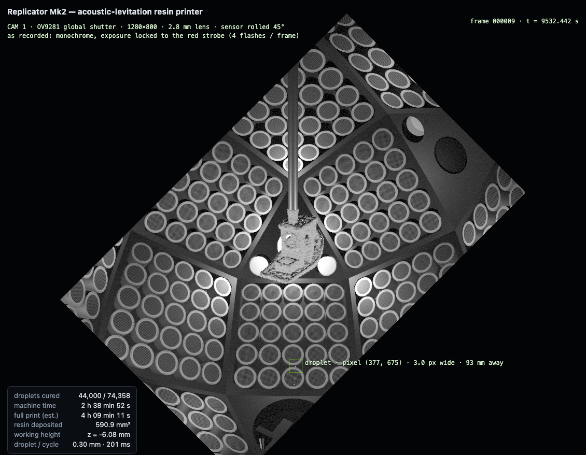
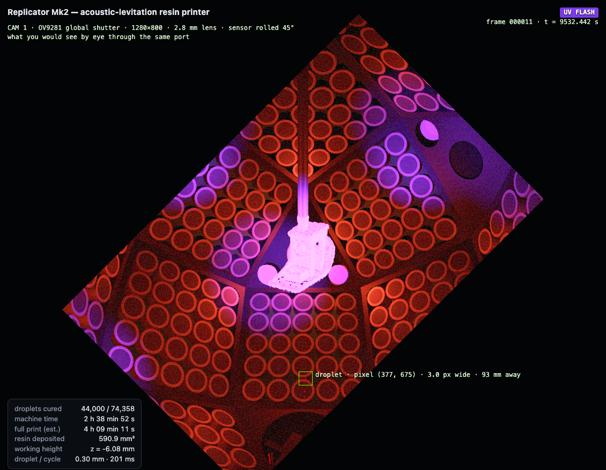
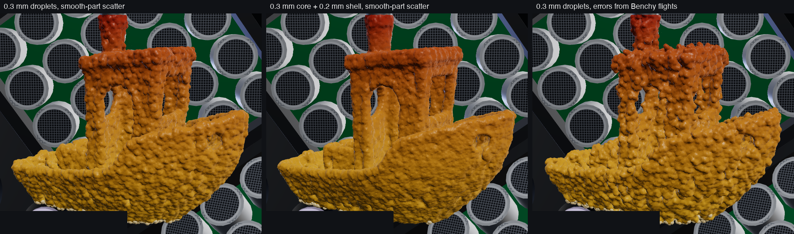

# Replicator Mk2 — feasibility report

Date: 2026-11-10. Everything below comes from the code and result files in this repository; the commands that reproduce each number are in [README.md](README.md).

## 1. Verdict

**The simulation says the idea is physically sound and worth a bench prototype. It does not, and cannot, confirm "without a doubt" that the built machine will print.** A simulation can only rule things out and show where the margins are. Four things stand between this design and a working printer, and none of them can be settled in software:

1. **The droplet generator has to be built and proven.** Nothing that can be bought fires single 0.3 mm droplets of this resin upward at 1.3 m/s with 1 % repeatability. The design now carries a home-built piezo generator based on a published, open-hardware one ([docs/droplet_generator.md](docs/droplet_generator.md)). No source reports its speed repeatability, and it has been shown at 0.5–1.4 mm, not 0.3 mm.
2. **Landing on real, thin geometry is unreliable in the simulation itself.** On a smooth 20 mm test part every one of 42 simulated flights landed, typically within 0.1 mm. On the real Benchy geometry 28 of 30 landed, and on one side-wall site a third of the droplets landed more than 1 mm from where they were aimed. The sound-field solver is also at its limit there (section 3.6).
3. **Nothing here has been compared with a measurement of this machine.** The acoustic solver is checked against exact solutions, but the transducer output, the foam's absorption at 40 kHz, air currents and the resin's cure behaviour are assumptions with stated margins.
4. **There is no firmware.** The circuit board is routed and checked; the program that makes it emit 25 phase-shifted signals does not exist yet.

For scale: the only published machine of this kind (AcoustoFab, UCL, 2025) places droplets to 0.7–1.1 mm at about 25 s per droplet. This design simulates 0.1–0.4 mm at 0.14–0.38 s per droplet. A gap that large between a simulation and the state of the art should be read as "the simulation is missing things", not as "this will be 100× better".

What the work does establish:

| Question | Answer | Basis |
|---|---|---|
| Can a 450-transducer array trap and steer a 0.3 mm resin droplet onto any side of a part without tearing it apart? | Yes in simulation, with a 2.5× margin on sound pressure | 42/42 flights on a smooth part with an imperfect machine; still lands at 40 % of the sound pressure |
| Does it still work as the part grows into a real shape? | Mostly; this is the weak spot | 28/30 flights on Benchy geometry; errors up to 2 mm on one site |
| Does a droplet-by-droplet print converge to the shape, without supports? | Yes. Mean surface error 0.06 mm (0.11 mm on edges) with one droplet size and 0.05 mm (0.09 mm on edges) with a fine outer shell, if landings scatter as they did on the smooth test part; 0.09 mm (0.13 mm on edges) with 4.5 % internal voids if they scatter as they did on Benchy geometry | three full print simulations with a capillary landing model (section 3.3) |
| Does the half-built part need structural support? | Not for strength: stresses are more than 100 times below the resin's strength. Thin walls that hang free can be pushed by tens of micrometres by the sound field while the resin is still soft; that is not in the print simulation | finite-element check of print snapshots under own weight and radiation pressure (section 3.6) |
| Is the hardware buildable as drawn? | Yes: no overlaps, every part fastened with its screws drawn, every wire terminated, and everything that has to come out comes out without hitting anything | automated checks on 1,197 solids, 224 conductors and 6 service motions (section 2.1) |
| Is the circuit board ready to order? | The files are complete and pass a connectivity check made from the files alone. No board has been built | section 2.2 |
| Can the parts be bought? | Yes, except that the droplet generator is made, not bought; 20 of 38 lines were opened on a supplier page today | section 6 |
| What does it cost? | About 1,400 USD without a host computer | section 6 |

## 2. The machine

Eighteen identical 58 mm boards, each with 25 ultrasonic transducers, sit on the square faces of a rhombicuboctahedron and all face the centre. The eight triangular faces are ports: the build pin hangs through the top one, the droplet generator fires up through the bottom one, cameras look in through the three upper side ports and red strobes shine in through the three lower ones. Eleven 405 nm emitters share the six side ports.

| | Cube (first design) | **Polyhedron (final)** | Ideal sphere |
|---|---|---|---|
| Transducers | 864 | **450** | 450 |
| Share of an ideal sphere's output reaching the centre | 64 % | **90 %** | 100 % |
| Trap stiffness, droplet weights per mm | 3.6 | **3.3** | 3.8 |

**Flexible boards or a true sphere** would gain the last 16 % of stiffness. That is not worth it: landings still succeed at 40 % of the sound pressure, so stiffness is not what limits this machine, while flexible boards would mean hand-soldering 450 through-hole parts to flex, separate driver boards and 450 signal wires. Rigid boards also make each face a self-contained, replaceable, self-calibrating module. Each board drops into a 1 mm deep pocket of the printed frame that locates it. The simulation puts a number on how precise that has to be: about 0.1 mm (section 3.2).

Key dimensions: transducer faces 70.0 mm from the centre; build volume 30 mm diameter × 30 mm; frame 177 × 204 × 175 mm; overall 466 × 348 × 425 mm with enclosure, heat sinks and drawer.

### 2.1 Printed structure, fasteners and service access

<!-- PRINTED_TABLE -->
| Part | Size (mm) | Volume (cm3) | One solid | Survives the weak-joint test |
|---|---|---|---|---|
| Frame cap: top port and the six upper board plates; lifts off (`frame_cap.stl`) | 156 x 162 x 76 | 51.4 | yes | yes |
| Lower frame: nine board plates, bottom port, three strobe ports, three leg bosses (`frame_lower.stl`) | 177 x 204 x 92 | 118.4 | yes | yes |
| Middle frame: upper halves of the six equatorial plates, three camera ports (`frame_mid.stl`) | 177 x 204 x 50 | 62.4 | yes | yes |
| Build-pin chuck (`chuck.stl`) | 58 x 40 x 36 | 15.7 | yes | yes |
| Leg (`stand_leg0.stl`) | 79 x 55 x 71 | 24.1 | yes | yes |
| Leg (`stand_leg1.stl`) | 79 x 55 x 71 | 22.4 | yes | yes |
| Leg (`stand_leg2.stl`) | 23 x 86 x 71 | 22.2 | yes | yes |
| Cartridge dock (`dock.stl`) | 68 x 62 x 4 | 6.7 | yes | yes |
| Droplet-generator body with drip tray (`jet_body.stl`) | 48 x 48 x 38 | 23.6 | yes | yes |
| Droplet-generator clamp ring (`jet_clamp.stl`) | 48 x 48 x 7 | 8.3 | yes | yes |
| Light-gate bracket (`gate_bracket.stl`) | 8 x 17 x 10 | 0.7 | yes | yes |
| Reservoir clamp (`res_clamp.stl`) | 12 x 16 x 20 | 3.7 | yes | yes |
| Camera pod (`pod0.stl`) | 33 x 46 x 49 | 5.7 | yes | yes |
| Camera pod (`pod1.stl`) | 33 x 46 x 49 | 5.7 | yes | yes |
| Camera pod with sensor shelf (`pod2.stl`) | 51 x 30 x 72 | 7.5 | yes | yes |
| **Total: 15 parts** | | **378** | | |
<!-- /PRINTED_TABLE -->

About 480 g of PETG. The largest part fits a 220 × 220 mm bed.

**How it is held together**

- The frame is three parts. The **lower frame** stands on three legs. The **middle frame** is screwed to it at six tabs; the six equatorial boards bridge that joint. The **cap** carries the six upper boards and the top port. It has no fastener: it rests by its own weight (about 0.3 kg) in three V-shaped notches of the middle frame, which locate it, and lifts straight off.
- Each **leg** is a flat web with a pad at the top and a foot at the bottom. One M4 screw goes up through the pad and the cartridge dock into an insert in a boss of the lower frame; one M5 bolt comes up through the enclosure floor into an insert in the foot.
- The **droplet generator** is a cartridge. It hangs on a horseshoe-shaped dock under the frame and slides out to the front after one thumb screw is undone. Its top flange is also the drip tray.
- The **build-pin chuck** sits in a conical seat in the top port and is held by two thumb screws. The pin is pressed by a thumb screw into a V-shaped bore, which is offset so that the clamped pin sits on the machine's axis; its top end rests against a stop.

Three things in the earlier model were wrong and are corrected:

- The legs were round rods that met a round column along a line. The automatic check accepted them because it only asked for parts to be within 0.3 mm of each other. Legs, pads and feet now overlap by several millimetres, and a new test peels 0.6–0.8 mm off every surface of each printed part and requires it to remain one piece.
- The pin clamp had a round bore of exactly the pin's diameter, a hole drilled through both walls, and a screw thread in bare plastic. A screw pushing a round pin into a round hole does not define where the pin sits. The bore is now a V, the screw runs in a brass insert, and the hole is on one side only.
- The chuck sat in the port with 0.2 mm of play. It now centres itself on a cone.

**Fasteners.** Every screw named in the model is drawn, with a clearance hole in what it passes through and a tapping hole or brass insert where it threads. The plywood box is glued; it has no screws except for hinges, window and switches.

<!-- FASTENER_TABLE -->
| Fastener | Count in the model |
|---|---|
| 3.5 mm x 16 mm wood screw, pan head | 8 |
| 3.5 mm x 9 mm wood screw, pan head | 8 |
| 3.5 mm x 9.5 mm wood screw, pan head | 8 |
| M2 x 10 mm socket-head screw | 4 |
| M2 x 5 mm socket-head screw | 12 |
| M2.5 heat-set insert (brass) | 10 |
| M2.5 x 5 mm socket-head screw | 4 |
| M2.5 x 6 mm socket-head screw | 2 |
| M2.5 x 8 mm socket-head screw | 16 |
| M2x8 thread-forming screw | 72 |
| M3 heat-set insert (brass) | 17 |
| M3 x 10 mm socket-head screw | 10 |
| M3 x 12 mm knurled thumb screw | 2 |
| M3 x 12 mm socket-head screw | 6 |
| M3 x 14 mm socket-head screw | 2 |
| M3 x 16 mm socket-head screw | 6 |
| M3 x 30 mm socket-head screw | 8 |
| M3 x 5 mm socket-head screw | 10 |
| M3 x 6 mm socket-head screw | 22 |
| M3 x 6.7 mm knurled thumb screw | 1 |
| M3 x 8 mm knurled thumb screw | 1 |
| M3 x 8 mm socket-head screw | 4 |
| M4 heat-set insert (brass) | 3 |
| M4 x 16 mm socket-head screw | 8 |
| M4 x 20 mm socket-head screw | 3 |
| M5 heat-set insert (brass) | 3 |
| M5 x 20 mm socket-head screw | 3 |
| **Total** | **253** |
<!-- /FASTENER_TABLE -->

**Checks** (`studies/s16_hardware.py`, results in `hardware/*.json`):

- **Overlap:** 1,197 solids, about 6,000 close pairs intersected exactly, 0 overlaps.
- **Nothing floats:** every part names what it is fastened to and how; the check confirms that it touches that part and that the chain of fastenings reaches the enclosure floor. 0 parts fail.
- **Printed parts are sound:** each of the 15 fuses to one solid and survives the peeling test.
- **Wiring:** 224 conductors, 51 m; every one starts and ends on a part; none passes through a solid.
- **Nothing collides when it is taken out or opened.** Six motions were stepped through and intersected with everything else at each position: chuck with pin and a 30 mm part up through the top port; cap with its six boards straight up by 100 mm; generator cartridge 110 mm to the front; door and lid through 95°; one board 25 mm out of its pocket. 0 collisions.
- Each check is itself tested by injecting a clash, a floating part, a wire through a board and a collision on a path, all of which it finds.

**Service.** The common jobs need no tools: part out (two thumb screws), reach inside the cage (lift the cap), clean or swap the generator (one thumb screw, slide out), reach the electronics (drawer front on magnets). A board is four screws and two plugs. The full table, the tool list and the order of assembly are in [docs/assembly_and_service.md](docs/assembly_and_service.md).

Limits of the hardware model: bought modules are plain blocks at their real outline size. Hinges are single blocks. Cable slack is not modelled, and cables are checked against solids but not against each other, so in the viewer some cables touch where a real harness would be tied side by side. Print orientation and supports were reasoned about, not sliced.

### 2.2 Transducer board (TB-25)

58 × 58 mm, 4 layers. Front: 25 transducers. Back: one RP2040 that generates all 25 phase-shifted 40 kHz square waves on GPIO4–28, 13 dual drivers rated to 30 V, an ultrasonic MEMS microphone that listens through a hole between four cans, RS-485, a 3-pin programming connector, and 49 small parts.

The board is routed. Layer 1 (under the transducers) is a ground pour, so no signal runs under a can rim; layer 2 is the drive-voltage plane with a 3.3 V island under the microcontroller; layers 3 and 4 carry 342 tracks, 1.26 m in total, and 235 vias.

How it was made ready for JLCPCB:

- Every footprint is the one JLCPCB's own parts library holds for the part number in the order, downloaded on 2026-11-10, so pads, pin numbers and placement origins are theirs. All 21 part numbers were in stock that day.
- A grid router with rip-up connects the netlist. The first attempts left 15–30 connections unrouted; turning the microcontroller by 90°, moving two drivers off its escape channels and re-assigning pins did more than any change to the router.
- The result is not trusted on the router's word. A separate check reads the Gerber and drill files back, rasterises the copper at 0.02 mm, rebuilds the connections from the pixels and compares them with the netlist: 120 nets, 367 pads, no open circuit, no short, clearances of at least 0.135 mm. On its first run it found a real fault that the router could not see (the microphone's ground ring is drawn as four separate arcs in the library) and slivers of floating copper in the planes. Both are fixed.
- The check is itself tested with an injected open circuit, short and clearance fault.

Changes forced by checking parts:

- The driver I had specified first (TC4427A) is rated to exactly 18 V, the voltage it would run at. It is replaced by the IX4427N (30 V).
- The crystal is now the one Raspberry Pi specifies for the RP2040.
- The microcontroller's 30 pins are all used. The RS-485 direction is derived from the transmit line with one transistor, and the LED is a power LED.

**What "ready to order" does not mean:** no board has been made, there is no firmware, and JLCPCB's own design-for-manufacture review has not been run. The order settings, the three things to check in their preview, and the bring-up steps are in [hardware/pcb/README.md](hardware/pcb/README.md).

### 2.3 Wiring

Wires are coloured by function, and the viewer shows a legend and names any wire you point at.

| Colour | Function |
|---|---|
| red | transducer drive supply (18–27 V) |
| black | ground / return |
| orange | +5 V logic |
| yellow / green | RS-485 A / B command bus |
| white | SYNC (restarts every board's 40 kHz period together) |
| violet | 405 nm LED strings |
| brown | red strobe LEDs |
| thick dark grey | camera USB |
| light blue | camera trigger |
| blue | piezo pulse of the droplet generator |

The boards form four chains: three chains of four boards on the lower and middle frame, and one chain round the six boards of the cap. Only the cap chain's two cables cross the cap joint, and they unplug at its first board. All cables run over the outside of the frame, clear of the ports, drop to a hole in the floor next to a leg, and continue to the hub in the drawer.

Pass-through holes: three 22 mm harness holes and one 14 mm service hole (generator leads, light gate) through the floor foam and floor; three 25 mm holes in the foam for the feet; four 10 mm holes in the drawer walls for the leads of the outside heat sinks; a pocket in the foam for the two interlock switches; a notch in the dock for the nozzle-heater leads.

### 2.4 Sensing and the digital twin

| Sensor | What it measures | Why |
|---|---|---|
| 3 global-shutter cameras, 1280 × 800, 2.8 mm lens, trigger input | droplet position in 3-D, landing point, part outline | to see why a droplet missed |
| 3 red strobes | light for the cameras; four flashes per frame give four droplet images | one frame gives a velocity |
| 18 ultrasonic microphones (one per board) | each transducer's real output and phase; speed of sound | self-calibration |
| Light gate above the nozzle | exit time and speed of each droplet | per-shot timing correction |
| Line laser | a height profile across the part | checks the model of the growing part |
| 2 air sensors (top and bottom of the cage) | temperature, humidity, pressure | speed of sound, stratification |

The cameras have no colour filter. They are exposed either during a red strobe (tracking frames) or during the UV flash (to see where the cure light falls). The supplied lens gives about 0.09 mm per pixel at the build centre, so a droplet is about 3 pixels wide: enough to locate it to perhaps a third of a pixel (0.03 mm) by centroiding, which is untested, and not enough to see its shape. Each camera board is mounted rolled 45° so its long diagonal follows the flight path from the nozzle to the pin.

**What the cameras cannot do:** the strobe directly opposite each camera back-lights only the middle ~8 mm of the build volume, so clean silhouettes are available near the centre only; elsewhere tracking relies on the droplet's glints against a subtracted background, which is untested.

Demonstrated in simulation (`studies/s12_twin.py`), on a machine built from uncalibrated cheap transducers (14° phase and 15 % amplitude scatter), with the air 1.5 K warmer than assumed and a steady draught:

- microphone calibration recovered the speed of sound to 0.02 m/s and reduced the phase error from 13.4° to 0.2° rms;
- a camera "trap test" (hold a droplet, measure where it rests) inferred the draught as 0.30 m/s against 0.20 true;
- landing error did not improve: 4 of 4 landed each time, median 81 µm before, 86 µm after calibration and 94 µm with the draught correction, differences that are within the scatter of four flights. The test site was an easy one. Calibration should matter most on the hard sites of section 3.2, where a 0.5 K temperature error alone moved landings by more than 1 mm; that was not re-run with calibration.

The microphone clips near 112 dB at 40 kHz, and one transducer at full drive produces about 117 dB at the far side of the cage, so calibration must run at reduced pulse width.

### 2.5 In-camera view

The viewer's "In-camera view" renders the scene from each camera's real position through a model of its lens and sensor: 2.8 mm focal length with barrel distortion, the rotated sensor outline, lens fall-off, a monochrome response and noise. The cage is lit only by what lights the real one: the three strobes and, for 20 ms after each landing, the eleven 405 nm emitters. A second setting shows the same view in colour, as the eye would see it through the port. A tracker overlay gives the droplet's pixel position and size.

This is a rendering, not an optical simulation: there are no shadows, no glints computed from the droplet's refraction, and no fluorescence.

## 3. What the simulation shows

### 3.1 Model chain and how each link was checked

| Link | Model | Check |
|---|---|---|
| Sound field of the array | each transducer as a piston (19 point sources) | against the closed-form piston field |
| Sound scattered by the growing part | boundary elements on a mesh refined to 0.1 mm at the landing site | against the exact series for a sphere; reciprocity to 2 × 10⁻⁴ |
| Force on the droplet | Gor'kov potential | levitation threshold 1741 Pa vs King's formula 1740 Pa |
| Droplet integrity | acoustic Bond number kept below 1.0 (break-up observed near 2.3) | static flattening equals the textbook −3/32 × Bond |
| Flight | drag, gravity, shape oscillation, 4 kHz field updates | jet speed vs an independent integration: 0.8211 vs 0.8207 m/s |
| Landing shape | capillary equilibrium on the local geometry, frozen at a 45° contact angle | against the ideal spherical cap |
| Imperfect machine | phase 3°, amplitude 5 %, 7-bit phase steps, air 0.5 K off, draught 0.3 m/s, 30 % unmodelled wall echo, jet 1 % speed and 0.3° | — |
| Structure of the half-built part | cube finite elements with incompatible modes on the print's voxels | cantilever plate within 2 % of beam theory |
| Radiation pressure on the part | surface integral of the boundary-element pressure | within 2 % of Gor'kov's formula on a small sphere |

All cross-checks pass (`validation/v1`–`v6`). One of them corrected me earlier (air drag on the rising droplet is 30 % of gravity, not negligible).

### 3.2 Landing tests on the final construction

Nozzle 82 mm below the centre, as drawn. Each flight is a full simulation: plan with the nominal model, fly on a perturbed machine.

| Target | Site | Landed | Median error (µm) | 9 in 10 within (µm) | Worst (µm) | Flight (ms) |
|---|---|---|---|---|---|---|
| Smooth 20 mm part | bottom | 12/12 | 111 | 269 | 286 | 135 |
| | lower 45° | 6/6 | 165 | 292 | 333 | 143 |
| | side | 12/12 | 78 | 182 | 294 | 326 |
| | upper 45° | 6/6 | 77 | 182 | 232 | 364 |
| | top | 6/6 | 113 | 194 | 210 | 383 |
| Bare pin tip | bottom | 6/6 | 185 | 253 | 305 | 156 |
| Benchy, 10 % printed | under-side | **4/6** | 372 | 504 | 558 | 171 |
| Benchy, 25 % printed | side wall | 12/12 | 358 | **1,326** | **2,025** | 341 |
| Benchy, 45 % printed | under-side | 12/12 | 159 | 384 | 488 | 148 |

Under-side sites are reached by "direct ascent": the droplet is fired from below and steered so its rise ends at the site, about 0.14 s. Other sites use "carry": catch, park, route round the part, press on, about 0.33–0.38 s.

**The Benchy rows are the honest summary of where this stands.** Early in the print the target is a thin chimney and two of six droplets were lost. On the side wall every droplet landed, but in the runs where the air was 0.5 K warmer than the controller assumed, four of four landed 1.2–1.3 mm away. The microphones measure the speed of sound to the equivalent of 0.03 K, so this particular error should be removable; that has not been simulated end to end.

Sensitivities, all on the final construction:

| Change | Result |
|---|---|
| 0.2 mm droplets instead of 0.3 mm | smooth part and Benchy under-side: 36/36 landed, median 69–88 µm; Benchy side wall: 10/12, median 269 µm |
| Sound pressure reduced to 71 % | 18/18 landed, median 55–202 µm |
| Sound pressure reduced to 50 % | 18/18 landed, median 35–92 µm |
| Sound pressure reduced to 40 % | 12/12 landed, median 92–116 µm (now limited by power, not by the droplet-integrity limit) |
| Resin viscosity 80 mPa·s instead of 30 | 6/6 landed, median 121 µm |
| Every board 0.1 mm out of place (rms, each axis), not known to the controller | 9/9 landed, median 63–112 µm: no penalty |
| Every board 0.2 mm out of place | 9/9 landed, median 98–503 µm |
| Every board 0.4 mm out of place | 9/9 landed, median 201–748 µm |
| Jet speed error, no light gate | lands up to ±3 %; accuracy degrades from ±1 % |
| Jet pointing error, uncorrected | 41 µm at 1°, 410 µm at 2°, lost at 6° |

The board-position rows set the requirement on the printed frame, and on how repeatably the cap seats: about 0.1 mm. A desktop printer holds roughly 0.1–0.2 mm, so this is marginal. The microphone calibration as written fits one phase per transducer; fitting each board's actual position from the same measurements is the same kind of problem but is not implemented, and would be the first thing to add.

### 3.3 Print simulation

Benchy at 40 % scale (24 × 12 × 19 mm, 997 mm³), hanging from the pin, built top-down with no supports. Every droplet is placed with the capillary landing model on the geometry as actually printed so far; lost droplets are detected and re-fired; up-facing skins wait until there is something underneath to land on.

<!-- PRINT_TABLE -->
| Print | Droplets | Machine time | Surface error, mean (µm) | on faces | on edges | Surface off by > 0.1 mm | Internal voids | Sites built |
|---|---|---|---|---|---|---|---|---|
| One droplet size (0.3 mm); landings scatter as on the smooth test part | 73,533 | about 4 h | 62 | 57 | 111 | 19 % | 1.2 % | 98.9 % |
| 0.3 mm core + 0.2 mm outer shell (0.2 mm deep); landings scatter as on the smooth test part | 126,006 | about 7 h | 51 | 47 | 87 | 14 % | 1.5 % | 99.4 % |
| One droplet size (0.3 mm); landing errors and losses drawn from the flights onto Benchy geometry | 72,463 | about 5 h | 86 | 82 | 127 | 34 % | 4.5 % | 97.5 % |
<!-- /PRINT_TABLE -->

Four things to know about these numbers:

- **They rest on the landing-error model.** The first two rows give every landing a random error of 0.125 mm on each axis (0.07 mm for the shell droplets). That is what the flights onto the smooth test part showed (0.13–0.18 mm rms). The flights onto real Benchy geometry were worse: 0.29 mm rms on under-side sites with 2 of 18 droplets lost, and 0.92 mm rms on the side-wall site. The third row draws every landing error and every loss from those Benchy flights instead. They are only 12–18 flights each, from three sites, applied to the whole print, but this row is the better picture of an uncalibrated machine. The shape still comes out; 4.5 % of the inside is void, 2.5 % of sites are never built and a third of the surface is off by more than 0.1 mm.
- **A lost droplet is assumed to be noticed, to fall clear of the part and to be fired again.** In the third print that happened on 7.5 % of shots. A droplet that instead sticks somewhere else on the part is not modelled.
- **An earlier figure was wrong.** I had measured the print's surface against a field that is not a true distance deep inside the part, and at sample points that were up to 0.03 mm off the surface. Both are fixed; the numbers above use the corrected measure.
- **Edges are limited mainly by droplet size.** Rounding every edge of the target with a ball the size of a 0.3 mm droplet's footprint already costs 94 µm on edges; for a 0.2 mm droplet, 78 µm; for 0.15 mm, about 29 µm (`studies/s17_resolution_floor.py`). The printed edges are 9–17 µm above those floors.

**What improves the edges.** Building the outer 0.2 mm of the part from 0.2 mm droplets is the second row of the table: edges go from 111 to 87 µm and faces from 57 to 47 µm, for 1.7 times the droplets and about 3 h more. The anchor hole on the bow, a faint dent in the first print, is a clear ring in the second.

How much of that gain is real depends on how well the small droplets land. The full print gave them 0.07 mm of scatter per axis. The 0.2 mm flights onto the smooth part and the Benchy under-side had a median error equivalent to 0.06–0.075 mm per axis and an rms equivalent to 0.08–0.085 mm, so 0.07 mm is inside the measured range but not at its cautious end. On a test piece (the top 7 mm of the model, where the cabin's window frames are) the edge error fell from 103 µm to 83 µm with 0.06 mm scatter and to 94 µm with 0.085 mm: a gain of 19 % or 9 %. On the side-wall site the small droplets landed no better than the large ones.

Variants that did not help further on the same test piece: small droplets only near edges (edges 96–99 µm, because the large droplets next to them bulge past the edge), and a thinner shell of 0.15 mm droplets (88 µm). So the simulation supports "edges 10–20 % sharper" and no more. The cost is print time, and a second nozzle size on the droplet generator, which is untested.

What I tried that did not work: a closed-loop "finishing" controller that measures the surface and adds droplets wherever material is missing. It removed almost all missing material and left a third of the surface proud by more than 0.1 mm, because cured resin cannot be taken off again. It is not in the code.

### 3.4 Speed

About 84 % of Benchy droplets land on under-side surfaces and take the fast direct route. Using the flight times of section 3.2 plus a 20 ms flash, the 73,500-droplet print takes about 4 h of machine time; the fine-shell print takes about <!-- FT -->7 h<!-- /FT -->.

Why not inkjet speed: sound can push a droplet with at most about three times its own weight before the pressure that holds it also tears it apart. That sets a floor of roughly 70 ms for a 35 mm flight, and the direct route is already within twice that. One channel here deposits about as much per second as one inkjet nozzle; inkjets are fast because they have thousands. Two droplets in flight at once is plausible (trap stiffness 2.1 each, statically); three is not (0.8). Two-at-once has not been simulated dynamically.

### 3.5 UV cure

With the emitters where they are drawn (11 × 1.2 W behind 20° lenses), a surface element of any orientation receives 0.24 W/cm² typically and 0.10 W/cm² at worst (`replicator/cure.py`). For a typical hobby resin that freezes the droplet's shape after about 17 ms of light and cures it through after about 46 ms in total; later flashes add to the dose because every flash lights the whole build zone.

The print model assumed a 30 mPa·s resin frozen 8 ms after touchdown, giving a 45° contact angle. Neither is available: the thinnest hobby resin found is 75–85 mPa·s, and the light takes ~17 ms. The two errors cancel: an 80 mPa·s droplet reaches the same 45° shape at 21 ms. The hobby resins' cure constants are not published, so the 17 ms is an assumption. The droplet generator now warms the resin at the nozzle to thin it; by my estimate a 0.3 mm droplet cools in air with a time constant of about half a second, so it lands partly warm and spreads faster than the model assumes. That is a bench adjustment of the flash delay, not a simulated result.

Risks not simulated: stray UV curing resin at the nozzle tip; a droplet in flight being partly cured by the previous flash; the first-printed material receiving several hundred J/cm² over a seven-hour print.

### 3.6 Does the half-built part need structural support?

The print simulation places every droplet on resin that is already cured, so nothing is ever printed in mid-air. What it did not do is ask whether the half-built part can carry itself. At 39 % of the fine-shell print, for example, the hull's rim and the cabin walls hang free from the roof before the deck exists.

`studies/s20_structure.py` turns snapshots of the print into finite-element models (0.18 mm cubes), fixed where the part meets the pin, and loads them two ways.

| Load | Largest stress | Largest movement (resin modulus 1 GPa) | Where |
|---|---|---|---|
| Own weight, all 17 snapshots of two prints | 0.06 MPa; 0.017 MPa where the part meets the pin | 11 µm | a free-hanging wall at 25 % of the first print; 2 µm or less elsewhere |
| Sound field during a delivery, three Benchy sites | 0.17 MPa | 28 µm anywhere on the part; 7 µm at the landing site | side-wall delivery at 25 % |

- **Strength is not an issue.** Hobby resins are quoted at about 30 MPa tensile strength after post-curing; the largest stress found is more than 150 times smaller.
- **The sound field pushes on the part about as hard as gravity does.** The net radiation force on the part reaches 1.4–2.2 mN during a delivery, against a part weight of 1.1–5 mN, and ten thousand times the droplet's weight. The pin bends by about 2 µm under it.
- **Movement scales inversely with the resin's stiffness.** One hobby resin's data sheet gives 0.5 GPa after post-curing, and a part that has only seen a few flashes is softer still. At 0.3 GPa the movements above become 37 µm (own weight) and 94 µm (sound). That is the size of the landing scatter. It is systematic, so a controller that knows the part's shape could aim off, but nothing here does that.
- **So supports are not needed, but print order matters.** The second print happened to close its thin walls sooner and sags 40 times less at the same stage (0.26 µm against 11 µm). Ordering the print to avoid long free walls is the cheap fix; it is not implemented.

Two cautions. First, on the thin side wall a third of the boundary-element panels gave surface pressures more than three times the largest incident pressure and had to be clipped; constant-panel boundary elements break down when two faces of a wall are closer together than a panel. The same solver plans the landings, so the side-wall landing results of section 3.2 carry the same doubt. Second, cure shrinkage and the stresses it leaves behind are not modelled at all; in other droplet-by-droplet processes they curl thin walls.

### 3.7 Heat

The array dissipates about 30 W at 18 V and about 50 W at the higher voltage that weak transducers need, inside a foam-lined box that would rise by tens of kelvin without cooling. Two Peltier assemblies are drawn, one on each side wall, each with a finned sink and a fan inside that draws chamber air toward the wall. Whether two units hold 28 ± 0.2 °C against 50 W is a rough estimate, not a calculation with the parts' performance curves.

## 4. Using it

1. Open the lid, drop a build pin into the chuck, tighten its thumb screw, seat the chuck in the top port, tighten its two thumb screws.
2. Close the lid and door (both interlocked: UV and drive power are cut when open).
3. Self-calibration: microphones measure every transducer and the speed of sound; a camera trap test measures the draught.
4. Print. The cameras log every droplet's flight and landing point.
5. Open the lid, undo the two thumb screws, lift the chuck out with the pin and the part through the 31 mm top port. Post-cure and remove from the pin.

Anything that falls lands in the drip tray on top of the generator cartridge under the bottom port; no transducer is within 23 mm of the vertical axis below the part. A drip screen is not needed. If one is wanted, an oleophobic acoustic vent mesh costs 3 % of trap stiffness at 0.7 dB loss and 6 % at 1.5 dB; I could not confirm that an individual can buy a small sheet.

## 5. Why build it, and what else it is good for

**Not to make parts.** A 200 USD resin printer is faster, finer and proven. This machine deposits about 250 mm³ per hour at 0.3 mm resolution.

What it would be is a research instrument with three unusual abilities: it places nanolitre volumes of liquid without touching them, from any direction, onto an object that is already there; and it carries its own sensors for comparing what happened with what was planned.

| Use | Why this machine fits | Closest published work |
|---|---|---|
| Adding material to an existing object from any side: repairs, features on curved surfaces, embedding a component | no nozzle has to reach the surface; the part does not have to be flat or upright | AcoustoFab (UCL, 2025) prints onto objects with 2.5 µL drops; LeviPrint (2022) assembles sticks with drops of UV glue |
| Multi-material at the droplet level | each droplet can come from a different cartridge | the same two |
| Handling small liquid samples without a container | mixing, evaporation and solidification without wall effects | acoustic levitators are used this way in chemistry and pharmacy (from memory, not checked today) |
| A general 450-channel ultrasonic array with a microphone on every board | mid-air haptics, acoustic holography, particle manipulation, volumetric displays | open arrays exist with fewer channels and no self-calibration (from memory) |
| Method papers | planning a sound field with the growing part inside the model; calibrating an array from its own microphones; a droplet generator characterised for speed repeatability, which no paper reports | — |

The honest ranking: the array and its calibration are the most reusable result; the droplet generator is the most likely to fail and the most publishable if it works; the printed Benchy is a demonstration, not a purpose.

A sister project on printing with light instead of sound is outlined in `~/Desktop/optical_tweezer_printer`.

## 6. Sourcing and cost

Supplier searches were run on 2026-11-10 (`out/sourcing/*.json`). "Verified" means a supplier page or the supplier's parts library for that exact part was read that day.

<!-- BOM_TABLE -->
| Item | Qty | Unit (USD) | Line (USD) | Supplier | Status |
|---|---|---|---|---|---|
| 40 kHz transmitter, 10 mm can, Sunny TCT40-10T2, guaranteed 110 dB (+25 spares) | 475 | 0.24 | 114 | Maritex | verified |
| TB-25 board: 4-layer PCB, parts and back-side assembly at JLCPCB (order 20; parts 15.7 USD each from their library prices, board and fees estimated) | 20 | 21.00 | 420 | JLCPCB | verified |
| Raspberry Pi Debug Probe (programs the boards through the 3-pin SWD connector) | 1 | 12.00 | 12 | Raspberry Pi resellers | listed |
| JST-SH 6-pin cable, 150 mm (bus jumpers and trunks) | 18 | 3.32 | 60 | Pololu 5543 | verified |
| JST-PH 2-pin cable (power jumpers and trunks) | 18 | 0.75 | 14 | Adafruit 261 | verified |
| Screws, by count in the model: 16 M2, 22 M2.5, 68 M3, 11 M4, 3 M5, 24 wood screws (assortment boxes M2 / M2.5 / M3 / M4, see hardware/fasteners.json) | 1 | 24.00 | 24 | any | generic |
| M3 knurled thumb screws (4 in the model: pin clamp, chuck, cap, cartridge lock) | 1 | 8.00 | 8 | any | generic |
| Heat-set inserts (33 in the model: M2.5, M3, M4, M5 assortment) | 1 | 21.00 | 21 | CNC Kitchen / Prusa | verified |
| PETG filament for frame, legs, dock, pods, chuck, cartridge body (~0.7 kg used) | 1 | 24.00 | 24 | Prusament | verified |
| Global-shutter camera InnoMaker U20CAM-9281M with trigger input and 2.8 mm M12 lens | 3 | 32.99 | 99 | inno-maker.com | verified |
| 405 nm LED Luminus SST-10-UV-A130-G405 + 20 mm star board for 3535 | 11 | 4.20 | 46 | Digi-Key / Cutter | verified |
| Lens for the UV LEDs, Ledil LISA2-RS-PIN (10 mm) | 11 | 1.68 | 18 | Digi-Key | verified |
| UV string driver Mean Well LDD-700L | 3 | 3.25 | 10 | Digi-Key | verified |
| Red LED on star, Cree XP-E2 | 3 | 5.25 | 16 | LEDSupply | verified |
| Opal acrylic sheet for strobe diffusers | 1 | 10.70 | 11 | US Plastic | listed |
| MOSFET driver for the strobes | 3 | 3.95 | 12 | Adafruit 5648 | verified |
| Line laser 650 nm 5 mW | 1 | 8.95 | 9 | Adafruit 1057 | verified |
| Slotted photo-interrupter Vishay TCST2300 (droplet light gate) | 2 | 1.54 | 3 | Digi-Key | verified |
| BME280 temperature / humidity / pressure breakout | 2 | 14.95 | 30 | Adafruit 2652 | verified |
| Raspberry Pi Pico (bus hub) + RS-485 breakout + prototyping board | 1 | 20.50 | 20 | Raspberry Pi / SparkFun | verified |
| Drive supply Mean Well LRS-100-24 (24 V 4.5 A, trims to 27 V) | 1 | 17.60 | 18 | Mouser | listed |
| Thermal supply 12 V 12.5 A (LRS-150-12 class) | 1 | 22.00 | 22 | Mouser | generic |
| Step-down converters: adjustable 5 A (drive voltage) and 5 V 3 A | 2 | 5.00 | 10 | any | generic |
| Peltier assembly 12 V 5 A with heat sink and fan | 2 | 34.95 | 70 | Adafruit 1335 | verified |
| Inside heat sink 100 x 70 x 25 mm + 120 mm PWM fan (Arctic P12) | 2 | 16.00 | 32 | any / Arctic | listed |
| H-bridge module BTS7960 | 1 | 5.00 | 5 | AliExpress | listed |
| Melamine foam sheet 48 x 24 x 1 in | 1 | 49.12 | 49 | Penn Tool Co | verified |
| Plywood 1/4 in for enclosure and drawer (4 panels 24 x 24 in), wood glue, glue blocks | 4 | 15.00 | 60 | any | generic |
| 405 nm blocking acrylic 24 x 12 x 1/8 in (door window) | 1 | 34.99 | 35 | J Tech Photonics | verified |
| Interlock switch Omron SS-5GL | 2 | 2.09 | 4 | Digi-Key | verified |
| Hinges (4), magnetic catches (6), gasket tape, cable ties and clips, wire | 1 | 45.00 | 45 | any | generic |
| Build pins: 2.5 mm stainless rod, cut to 100 mm (20 pcs) | 1 | 8.00 | 8 | any | generic |
| UV resin 1 kg (thinnest found: Anycubic High Speed 2.0, 75-85 mPa.s) | 1 | 32.00 | 32 | Anycubic | listed |
| Droplet generator: piezo disc CUI CEB-35D26 (2), spare included | 2 | 2.50 | 5 | Digi-Key 102-1128-ND | listed |
| Droplet generator: brass M6 3-D printer nozzles 0.2 / 0.25 / 0.3 / 0.4 mm (set) | 1 | 9.00 | 9 | any 3-D printer parts shop | generic |
| Droplet generator: hot-end heater block + M6 heat break + 24 V heater cartridge + 100 k thermistor | 1 | 12.00 | 12 | any 3-D printer parts shop | generic |
| Droplet generator: O-rings (1-1/4 in ID x 1/16 in for the piezo; 1/8 in ID for the feed tube), 10-24 hose barbs, 1/8 in opaque tubing, 10 mL syringes | 1 | 22.00 | 22 | McMaster-Carr 9452K113, 94115K006 | listed |
| Droplet generator: dual H-bridge for the piezo pulse (L293D or DRV8871) + small adjustable 5-30 V converter + logic-level MOSFET for the heater | 1 | 14.00 | 14 | Digi-Key / any | generic |
| **Total** | | | **1422** | | 20 of 38 lines verified |
<!-- /BOM_TABLE -->

Not included: a host computer. Any PC works; a Raspberry Pi 5 (4 GB) was 130 USD that day.

How the estimate has moved: 1,055 USD before any part was checked; 1,700 USD after, with a 400 USD placeholder for a bought droplet valve; about 1,400 USD now, with the home-built generator (about 60 USD) and the boards re-costed from JLCPCB's library prices (the genuine 30 V drivers alone are 8.30 USD per board).

**Items that are not settled:**

| Item | Problem | What would have to change |
|---|---|---|
| Droplet generator | built from a published design, outside the range it was shown in (smaller droplets, warmed resin, firing up); speed repeatability unknown | larger droplets, or a micro-valve by quotation |
| Second, finer droplet size | the 0.2 mm shell droplets need a second nozzle or cartridge; untested | print with one droplet size |
| Resin | no hobby resin documents a viscosity under 60 mPa·s; none publishes cure constants; the generator relies on warming it | thin with a reactive diluent and re-measure |
| Transducers | the cheapest part guarantees 110 dB, 10 dB below the part the model's output figure was measured on. At 27 V it reaches about 47 % of the simulated sound pressure; landings were simulated down to 40 % | a 115 dB-class part (about 75 % at 24 V), or the 120 dB part at 4.28 USD each (+1,900 USD) |
| Acoustic foam | no absorption data exists at 40 kHz for any foam found | the microphones can measure the echoes; the simulation includes a 30 % unmodelled echo |
| Firmware | not written | — |

Three background research tasks (droplet generators, JLCPCB rules, resin mechanics) stopped twice on a usage limit and left partial files. What they did find is used above and kept in `out/sourcing/`; the board's part numbers and footprints were then read directly from JLCPCB's library instead.

## 7. Bench tests, in the order that would kill the project soonest

1. **Droplet generator on its own:** single 0.3 mm droplets of the chosen resin, upward, 1.3 m/s. Measure speed scatter and satellites with one camera and two light gates. If this fails, nothing else matters.
2. **One board:** drive 25 transducers, measure output and phase scatter with the board microphone and one external microphone. Fixes the real sound pressure per volt.
3. **Hold one droplet:** three boards are enough. Measure the break-up limit and the trap stiffness against the model.
4. **Catch a fired droplet and land it on a pin.** Compare the landing scatter with the first row of section 3.2.
5. **Cure:** flash one landed droplet; measure the frozen shape against the 45° assumption, and the stiffness of a thin wall a few seconds after printing.
6. **Full cage:** repeat the smooth-part sites, then a 10-droplet line, then a free-standing wall. Only then a Benchy.

## 8. Files

`hardware/replicator_mk2.step` (assembly), `hardware/print/*.stl` (15 printed parts), `hardware/pcb/` (board: Gerbers, drill files, JLCPCB BOM and placement, routing report), `hardware/bom.json`, `hardware/fasteners.json`, `hardware/wiring.json`, `hardware/*_report.json` (checks), `docs/droplet_generator.md`, `docs/assembly_and_service.md`, `out/mc_summary.json` (every landing test), `out/print*/result.json` and `edges.json` (prints), `out/structure_*.json` (structural check), `out/sourcing/*.json` (supplier checks). The viewer is at `http://127.0.0.1:8791/viewer/` after `viewer/serve.py`.
